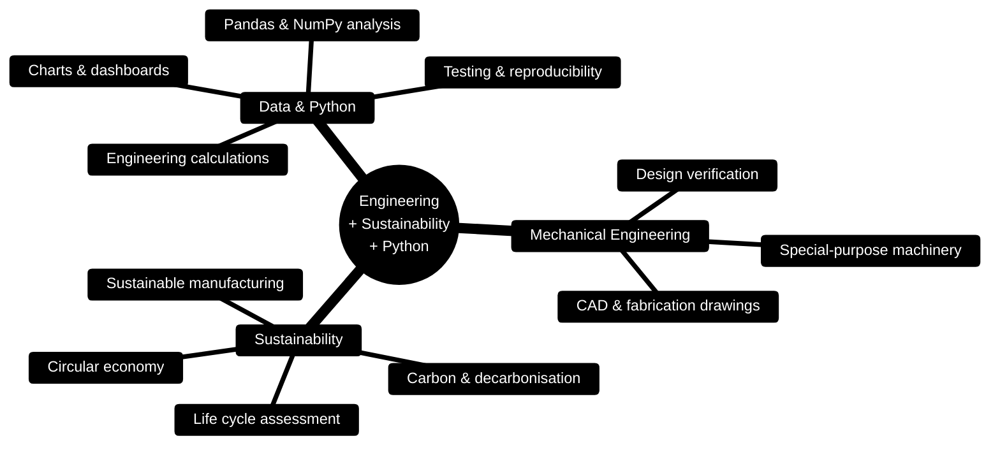
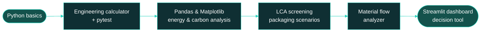

  

---

## 👋 About Me

I'm a **mechanical engineer moving into sustainability and data-driven engineering**. I hold a Bachelor's degree and a Diploma in Mechanical Engineering, and I'm pursuing an **M.Sc. in Sustainability Management and Technologies at Technische Hochschule Ingolstadt (THI), Germany**.

Before my Master's, I worked as a **Design Engineer in the Emergency Restoration System (ERS) department at Advait Energy Transitions Limited**: production and fabrication drawings, component development, engineering documentation and design verification.

This GitHub is where I combine that foundation with **Python** to build transparent, documented tools for engineering calculations, material flows, energy and carbon analysis, and early-stage life cycle screening.

---

## 🧭 Focus Map

---

## 🛠️ Tech & Skills

**Engineering tools (professional / academic experience)**

**Currently learning (through hands-on projects)**

---

## 🚀 Featured Projects

> Statuses are real. Nothing here claims results I haven't produced.

| Project | What it will do | Status |
|---|---|---|
| 🔩 **mechanical-component-calculator** | Stress, strain, factor of safety and beam calculations with documented assumptions, input validation and pytest checks against hand calculations | 🟡 Planned – first project |
| 🧴 **sustainable-packaging-lca** | Educational screening comparison of packaging scenarios (e.g. virgin vs. recycled HDPE content) using clearly labelled illustrative data, with sensitivity analysis | ⚪ Planned |
| 🏭 **manufacturing-energy-analysis** | Energy per part, emissions estimates with documented factors, anomaly detection on synthetic or open data | ⚪ Planned |
| 🔄 **circular-economy-material-flow** | Material flow accounting, mass-balance checks, recycling and recovery rates | ⚪ Planned |

---

## 🎓 Academic Work

**Sustainable plastic packaging, industry project with SONAX (THI).** Explored packaging alternatives, including a bottle with 30 % recycled HDPE (rHDPE) and CleanFlake label technology, through an initial life cycle assessment phase and circular-economy thinking. My GitHub work in this area is an **independent, educational** re-creation using public or clearly illustrative data. It does not publish company data or project results.

---

## 📈 Learning Roadmap *(plan, not completed work)*

---

## 📊 Live GitHub Activity

  

 

<picture>
  <source media="(prefers-color-scheme: dark)" srcset="https://raw.githubusercontent.com/devpanchal/devpanchal/output/github-snake-dark.svg"/>
  
</picture>

These three graphics are generated from my real GitHub activity, so they look empty until I start publishing work. That is expected.

---

## 🤝 Let's Connect

Open to conversations in **mechanical design, sustainability, manufacturing, energy, circular economy and engineering data analysis**, in Germany and internationally.

- 💼 LinkedIn: [YOUR_LINKEDIN](https://www.linkedin.com/in/YOUR_LINKEDIN)
- 📧 Email: your.email@example.com
- 📍 Germany

